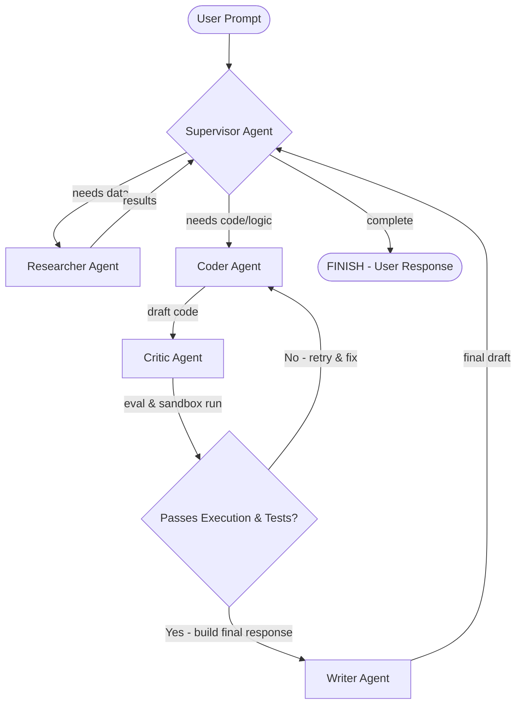

# 🛠️ AgentForge

AgentForge is an advanced multi-agent orchestrator built on **Next.js 15 (App Router)**, **LangGraph**, **MongoDB**, and **Google Generative AI (Gemini)**. It features a collaborative agent graph, semantic Retrieval-Augmented Generation (RAG), secure code sandbox execution, and a background AI Cron scheduler with automatic GitHub auditing and email notifications.

---

## 🌟 Key Features

- **🧠 Multi-Agent Collaborative Graph**: Powered by LangGraph, coordinating multiple specialized AI agents:
  - **Supervisor**: Analyzes workspace tasks and routes execution to specialist agents.
  - **Researcher**: Queries the database RAG index and performs real-time Google Web Search grounding.
  - **Coder**: Implements precise code blocks and technical solutions.
  - **Critic**: Performs safety/security checks, executes generated code in a secure sandbox, and feeds stdout/stderr logs back. Auto-routes back to the Coder on failure.
  - **Writer**: Formats, compiles, and structures the final response into premium Markdown.
- **⚡ Secure Code Sandbox**: Evaluates python/typescript/javascript code blocks in real-time to guarantee functionality before the user sees the output.
- **⏰ Background AI Cron Engine**: Runs background schedules directly inside the Next.js runtime.
  - **GitHub Auditing**: Clones repository, ingests code files for dynamic RAG context, runs audit prompts, cleans up clones/vector db entries, and logs sessions.
  - **Email Alerts**: Integrates SMTP mail alerts to report success/failure with full logs and session links.
- **🔒 MongoDB-Backed Rate Limiting**: Built-in sliding-window rate limiter ensuring users respect request-per-minute (RPM) and request-per-day (RPD) limits.
- **📂 RAG File Ingestion**: Ingests uploaded workspace documents into a MongoDB vector store database.

---

## 📐 Architecture & Agent Flow

The orchestration flow is modeled as a state graph with feedback loops:



---

## ⚙️ Tech Stack

- **Framework**: [Next.js 15](https://nextjs.org/) (React 19, App Router)
- **Agent Orchestration**: [LangGraph](https://github.com/langchain-ai/langgraphjs) / [LangChain](https://js.langchain.com/)
- **AI Models**: Google Generative AI (Gemini 2.5 Flash / Gemini 2.0 Flash fallback)
- **Database & RAG**: [MongoDB](https://www.mongodb.com/) / [Mongoose](https://mongoosejs.com/)
- **Styling**: [Tailwind CSS](https://tailwindcss.com/)
- **Mailer**: [Nodemailer](https://nodemailer.com/)

---

## 🚀 Getting Started

### 📋 Prerequisites

Ensure you have the following installed on your machine:
- Node.js (v18.x or later)
- MongoDB instance (Atlas or local)

### 🔧 Environment Setup

Create a `.env` file in the root directory and populate it with your environment variables:

```env
# MongoDB Connection String
MONGODB_URI="mongodb+srv://<username>:<password>@<cluster>.mongodb.net/<dbname>"

# Gemini API Credentials
GEMINI_API_KEY="your-gemini-api-key"

# Authentication Secrets
AUTH_SECRET="your_nextauth_jwt_secret"

# (Optional) Google OAuth Configuration
AUTH_GOOGLE_ID="google_oauth_client_id"
AUTH_GOOGLE_SECRET="google_oauth_client_secret"

# UploadThing configuration (for file uploads)
UPLOADTHING_TOKEN="your_uploadthing_token"

# SMTP / Email Configuration (For Scheduler alerts)
SMTP_HOST="smtp.gmail.com"
SMTP_PORT=587
SMTP_USER="your-email@gmail.com"
SMTP_PASS="your-app-password"
SMTP_FROM='"AgentForge" <your-email@gmail.com>'
```

### 📦 Installation

Install all required dependencies:

```bash
npm install
```

### 💻 Running Locally

Start the Next.js development server:

```bash
npm run dev
```

Open [http://localhost:3000](http://localhost:3000) with your browser to experience AgentForge.

### 🏗️ Building for Production

Compile the production bundle:

```bash
npm run build
npm start
```

---

## 🗄️ Database Models Reference

- `User`: User profile, credentials, and settings.
- `Workspace`: Tenant separation for team collaborative workspaces.
- `Session`: Individual chat workspaces containing message sequences.
- `Message`: Chat history with intermediate agent execution steps and file attachments.
- `CronJob`: Scheduled background tasks, tracking intervals and last execution status.
- `VectorDocument`: Chunked text with embedded vectors for search.
- `ActivityLog`: Trace logs auditing background worker executions and actions.
