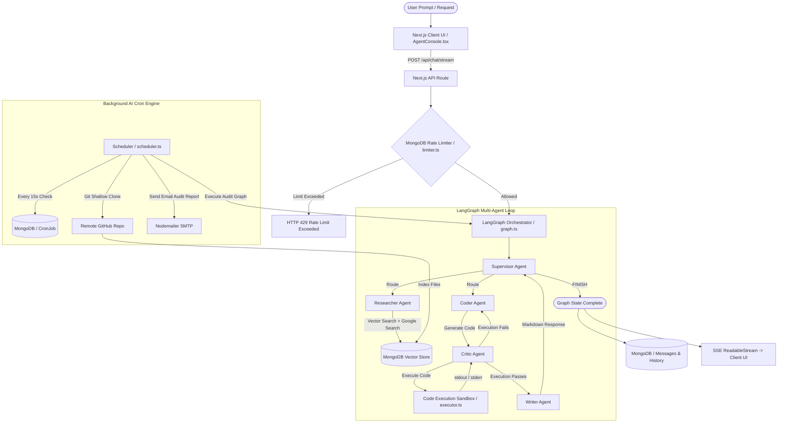

# 🚀 AgentForge: Complete System Architecture, Workflow & 50 Technical Interview Q&A Guide

Welcome to the comprehensive interview preparation guide for **AgentForge**. This document covers system architecture, end-to-end workflows, and **50 detailed interview questions with simple English answers, file references, and follow-up probing questions** to help you excel in technical interviews.

---

## 📐 1. System Architecture & High-Level Overview

AgentForge is a **full-stack multi-agent AI orchestration platform** built with Next.js 15, LangGraph.js, MongoDB, and Tailwind CSS. It enables users to create collaborative agent teams that execute multi-step reasoning, perform RAG (Retrieval-Augmented Generation) search, execute generated code in a secure sandbox, and schedule automated repository audits via background cron workers.



---

## 🔄 2. Complete End-to-End Workflow Breakdown

### Input ➡️ Processing ➡️ Execution ➡️ Output Flow

1. **User Input Phase**:
   - The user enters a prompt (e.g., *"Write a Python script to sort a list of dictionary items and verify its execution"* or *"Audit repo https://github.com/user/repo"*).
   - The client sends a `POST` request to `/api/chat/stream` with the user's message and workspace ID.

2. **Rate Limiting & Authentication**:
   - The request hits [limiter.ts](file:///c:/Users/Sukumar/Desktop/node%20basics/projects/AgentForge/src/lib/ratelimit/limiter.ts).
   - MongoDB queries sliding-window counts (1 minute for RPM, 24 hours for RPD). If under quota, execution proceeds.

3. **LangGraph State Initialization**:
   - In [graph.ts](file:///c:/Users/Sukumar/Desktop/node%20basics/projects/AgentForge/src/lib/agents/graph.ts), an `AgentState` object is instantiated containing `messages`, `sender`, `codeResults`, and `workspaceId`.

4. **Supervisor Routing & Specialist Node Execution**:
   - **Supervisor**: Analyzes prompt intent and delegates task to `Researcher`, `Coder`, or `Writer`.
   - **Researcher**: Searches vector embeddings in MongoDB ([embedder.ts](file:///c:/Users/Sukumar/Desktop/node%20basics/projects/AgentForge/src/lib/rag/embedder.ts)) or falls back to regex keyword search + Google Search grounding.
   - **Coder**: Generates code blocks (`js`, `ts`, `python`).
   - **Critic & Sandbox**: Extracts code blocks and sends them to [executor.ts](file:///c:/Users/Sukumar/Desktop/node%20basics/projects/AgentForge/src/lib/sandbox/executor.ts), executing code via isolated Node/Python processes with a 15-second timeout.
     - *If code fails*: Output (`stderr`) is passed back to `Coder` to fix bugs automatically (Self-Healing Loop).
     - *If code passes*: Returns `PASS` and advances to `Writer`.
   - **Writer**: Compiles technical summaries and code into clean Markdown.

5. **Streaming & Output Presentation**:
   - The result is streamed back real-time using `ReadableStream` with `text/event-stream` headers to `AgentConsole.tsx`.
   - The final output is saved asynchronously to MongoDB `Message` and `Chat` models.

---

## 🎯 3. 50 Interview Questions, Simple Answers & Follow-ups

---

### Section 1: Core System Architecture & Workflow (Q1–Q10)

#### Q1: What is AgentForge and what core problem does it solve?
- **Simple Answer**: AgentForge is a platform that uses a team of specialized AI agents (Supervisor, Researcher, Coder, Critic, Writer) working together. Instead of asking one single AI to do everything, AgentForge delegates tasks to specialist agents and tests generated code automatically before giving the user an answer.
- **Follow-up Question**: *Why split tasks among multiple agents instead of using one big prompt?*
- **Follow-up Answer**: Single large prompts suffer from context confusion and hallucination. Specialized agents have focused prompts, reduced token usage per step, and isolated feedback loops (e.g. code validation happens independently before final output generation).

#### Q2: What technology stack did you use to build AgentForge?
- **Simple Answer**: 
  - **Frontend**: Next.js 15 (App Router), React, Tailwind CSS, TypeScript.
  - **AI & Agents**: LangGraph.js, LangChain, Google Gemini 2.5/3.5 models.
  - **Backend & Database**: Node.js, MongoDB (Mongoose), Vector Search.
  - **Utilities**: Nodemailer (emails), child_process (code sandbox), custom sliding-window rate limiter.
- **Follow-up Question**: *Why Next.js 15 over a traditional Express backend?*
- **Follow-up Answer**: Next.js 15 provides unified client-server architecture, API routes with native streaming support (`ReadableStream`), and optimized bundle rendering, eliminating the need to manage separate frontend/backend servers.

#### Q3: How does the application handle user requests in real time?
- **Simple Answer**: It uses Server-Sent Events (SSE) over a HTTP `POST` route (`/api/chat/stream`). The server streams live progress updates (which agent is working, code execution output, final text) as chunks to the UI so the user sees results immediately without reloading.
- **Follow-up Question**: *Why standard SSE over WebSockets?*
- **Follow-up Answer**: SSE works natively over standard HTTP/1.1 and HTTP/2 with simpler fallback handling, firewalls compatibility, and lower infrastructure overhead when data flows unidirectionally from server to client.

#### Q4: How is state maintained across different agent steps?
- **Simple Answer**: LangGraph maintains a shared `AgentState` object. Every agent node receives this state, performs its work, and returns state updates. The state uses custom message reducers (`(x, y) => x.concat(y)`) to safely append message history.
- **Follow-up Question**: *What happens if two agents try to update the state at the same time?*
- **Follow-up Answer**: LangGraph executes nodes sequentially along defined edge paths, preventing concurrent state race conditions.

#### Q5: What happens when a user submits a prompt with a repository link?
- **Simple Answer**: The system creates a background audit job in MongoDB. A background worker clones the GitHub repo (`git clone --depth 1`), parses files under 50KB, converts code into vector embeddings, indexes them, runs audit analysis via agents, and emails a summary report to the user.
- **Follow-up Question**: *Why shallow clone with `--depth 1`?*
- **Follow-up Answer**: Full clones download entire git commit histories which waste bandwidth and disk space. `--depth 1` fetches only the latest commit snapshot, reducing clone time by over 90%.

#### Q6: How are user sessions and workspace permissions handled?
- **Simple Answer**: Users log in via NextAuth / JWT. Each workspace has owner and member references stored in MongoDB. Middlewares ([middleware.ts](file:///c:/Users/Sukumar/Desktop/node%20basics/projects/AgentForge/src/middleware.ts)) verify session tokens before allowing access to API routes or workspace data.
- **Follow-up Question**: *How do you prevent a user from accessing another user's workspace?*
- **Follow-up Answer**: Every workspace API query filters by both `workspaceId` and `userId` derived from the verified session token.

#### Q7: Where are file uploads stored and processed?
- **Simple Answer**: Small text files and code documents are chunked and converted into vector embeddings stored directly in MongoDB `VectorDocument` collection. Large file attachments use UploadThing integration.
- **Follow-up Question**: *What chunk size and overlap did you choose for text processing?*
- **Follow-up Answer**: We use 1000-character chunks with a 200-character overlap ([embedder.ts](file:///c:/Users/Sukumar/Desktop/node%20basics/projects/AgentForge/src/lib/rag/embedder.ts)) to preserve sentence context across chunk boundaries.

#### Q8: How does the system recover if an AI agent generates invalid output?
- **Simple Answer**: The system uses a **Self-Healing Feedback Loop**. The `Critic` agent runs generated code in the sandbox. If execution fails, the error traceback (`stderr`) is passed back to the `Coder` agent with instructions to fix the error.
- **Follow-up Question**: *How do you prevent infinite loops if the code keeps failing?*
- **Follow-up Answer**: The supervisor node caps recursion depth to a maximum number of graph iterations (e.g. 10 steps), after which it gracefully exits and alerts the user.

#### Q9: What is the main difference between Server Actions and API Routes in your app?
- **Simple Answer**: API Routes (`/api/chat/stream`) are used for long-running streaming responses (SSE). Server Actions ([actions.ts](file:///c:/Users/Sukumar/Desktop/node%20basics/src/app/dashboard/actions.ts)) are used for quick form mutations like creating workspaces or updating user profiles.
- **Follow-up Question**: *Can Server Actions stream data back to the client?*
- **Follow-up Answer**: While React DOM supports async Server Components, standard HTTP response streaming with custom headers (like `text/event-stream`) is cleanest and most reliable inside API Route handlers.

#### Q10: How do you measure system activity and log background tasks?
- **Simple Answer**: We maintain an `ActivityLog` collection in MongoDB. Every agent execution, sandbox run, cron job start, or error writes a structured log entry containing workspace ID, event type, status, and duration.
- **Follow-up Question**: *How do you prevent `ActivityLog` from filling up the database storage?*
- **Follow-up Answer**: We can apply TTL (Time-To-Live) indexes on the log collection or run nightly cleanup aggregation pipelines to auto-delete records older than 30 days.

---

### Section 2: Multi-Agent Orchestration & LangGraph.js (Q11–Q20)

#### Q11: What is LangGraph.js and why did you choose it over LangChain chains?
- **Simple Answer**: LangChain chains are strictly linear (A ➡️ B ➡️ C). LangGraph.js allows cyclic graph architectures with loops, branches, and conditional decisions (A ➡️ B ➡️ decision ➡️ back to A or finish). This is essential for agent reflection and code correction loops.
- **Follow-up Question**: *Can you describe the nodes in your graph?*
- **Follow-up Answer**: Yes! [graph.ts](file:///c:/Users/Sukumar/Desktop/node%20basics/projects/AgentForge/src/lib/agents/graph.ts) defines 5 nodes: `supervisor`, `researcher`, `coder`, `critic`, and `writer`.

#### Q12: How does the Supervisor Agent decide which agent to run next?
- **Simple Answer**: The Supervisor node passes the conversation history to an LLM with structured output formatting (JSON/Tool calls). The LLM evaluates the state and returns the next agent's name (`Researcher`, `Coder`, `Writer`) or `FINISH`.
- **Follow-up Question**: *What happens if the Supervisor returns an invalid node name?*
- **Follow-up Answer**: We use Zod schema validation on the LLM output. If parsing fails, it defaults safely to `Writer` or returns `FINISH` to prevent system crashes.

#### Q13: Explain the role of the Critic Agent.
- **Simple Answer**: The Critic agent acts as a quality assurance gatekeeper. It inspects code generated by the `Coder`, extracts code blocks, sends them to the execution sandbox, and evaluates stdout/stderr to determine if the output is valid (`PASS`) or buggy (`FAIL`).
- **Follow-up Question**: *Does the Critic rewrite the code itself?*
- **Follow-up Answer**: No, the Critic only evaluates and attaches execution feedback. If code fails, it routes back to the `Coder` node so the Coder can fix its own work based on the error log.

#### Q14: How does the Researcher Agent combine internal RAG data with web search?
- **Simple Answer**: The Researcher first queries MongoDB vector embeddings for private workspace knowledge. If context is insufficient or requires live data, it invokes Google Search Grounding to fetch live web information before combining both into a single research summary.
- **Follow-up Question**: *How do you prevent duplicate information between vector RAG and Google search?*
- **Follow-up Answer**: System instructions order the LLM to prioritize local vector context and use Google Search strictly for missing real-time facts or external package documentation.

#### Q15: What is a custom message reducer in LangGraph?
- **Simple Answer**: It is a rule that defines how new messages merge into the state array. Instead of overwriting existing messages, `(x, y) => x.concat(y)` appends new messages to the existing array, preserving complete conversation history.
- **Follow-up Question**: *What happens if the message history becomes too long for the LLM token context window?*
- **Follow-up Answer**: We can apply message trimming utilities (`trimMessages`) to prune older middle messages while preserving the system prompt and latest user inputs.

#### Q16: How do conditional edges work in LangGraph?
- **Simple Answer**: A conditional edge is a routing function placed after a node. It checks state variables (like `nextAgent` or `criticStatus`) and dynamically decides which node to execute next.
- **Follow-up Question**: *Where are conditional edges used in AgentForge?*
- **Follow-up Answer**: After `supervisor` (routes to specialist or `END`) and after `critic` (routes back to `coder` if `FAIL`, or to `writer` if `PASS`).

#### Q17: How do you stream agent progress steps to the frontend?
- **Simple Answer**: We stream intermediate state events using LangGraph's `.stream()` API. As each node completes, an event payload containing `{ agent: "Coder", content: "..." }` is formatted into an SSE data line and written to the HTTP response stream.
- **Follow-up Question**: *How does the frontend parse these SSE messages?*
- **Follow-up Answer**: In [AgentConsole.tsx](file:///c:/Users/Sukumar/Desktop/node%20basics/projects/AgentForge/src/components/workspace/AgentConsole.tsx), we read `response.body.getReader()`, decode bytes into text, split by `\n\n`, and update React state based on `event:` types (`agent_start`, `agent_step`, `agent_complete`).

#### Q18: What model provider is used for agents and how are fallback models configured?
- **Simple Answer**: We use `@langchain/google-genai` connecting to Gemini models. If a high-tier model hits rate limits or latency issues, we can configure automatic fallback to secondary models (e.g. Gemini 2.5 Flash).
- **Follow-up Question**: *Why choose Gemini models over OpenAI GPT-4?*
- **Follow-up Answer**: Gemini offers competitive reasoning performance, massive context window support (up to 1M+ tokens), native Google Search grounding capabilities, and lower API cost.

#### Q19: How do you pass workspace-specific settings to agent tools?
- **Simple Answer**: When initializing the graph execution in `/api/chat/stream`, `workspaceId` and configurations are injected into the initial `AgentState` object, making them accessible to all agent nodes during invocation.
- **Follow-up Question**: *Are agent tools stateless or stateful?*
- **Follow-up Answer**: Agent tools are functional and stateless; they take input arguments along with state context and return execution results without maintaining internal server memory.

#### Q20: How do you debug stuck loops in multi-agent graphs?
- **Simple Answer**: We log every node entry/exit in `ActivityLog` and set a `recursionLimit: 15` in `graph.invoke()`. If the loop count exceeds the limit, LangGraph automatically throws a recursion error caught by our API route error handler.
- **Follow-up Question**: *How do you inspect previous executions during development?*
- **Follow-up Answer**: We check the MongoDB `ActivityLog` entries and output console logs printed during sandbox execution and agent state updates.

---

### Section 3: Secure Code Execution Sandbox (Q21–Q28)

#### Q21: What is the purpose of the Code Execution Sandbox in AgentForge?
- **Simple Answer**: To verify whether code generated by AI actually compiles and runs correctly before delivering the final answer to the user.
- **Follow-up Question**: *Which file handles sandbox execution?*
- **Follow-up Answer**: [executor.ts](file:///c:/Users/Sukumar/Desktop/node%20basics/projects/AgentForge/src/lib/sandbox/executor.ts).

#### Q22: How does the sandbox extract code blocks from markdown?
- **Simple Answer**: It uses Regular Expressions (Regex) to scan for markdown code fences (e.g., ` ```python ... ``` ` or ` ```typescript ... ``` `) and captures the inner source code string.
- **Follow-up Question**: *What languages are currently supported by the sandbox?*
- **Follow-up Answer**: JavaScript (`js`/`javascript`), TypeScript (`ts`/`typescript`), and Python (`py`/`python`).

#### Q23: How does the sandbox execute code on the server?
- **Simple Answer**: It writes code string into a temporary file in `.sandbox/`, then uses Node's `child_process.exec` to run the runner binary (`node` for JS, `npx --yes tsx` for TS, `python` for Python), capturing `stdout`, `stderr`, and `exitCode`.
- **Follow-up Question**: *What happens to the temporary file after execution?*
- **Follow-up Answer**: A `finally` block immediately deletes the temporary file using `fs.unlinkSync` to ensure no disk clutter remains.

#### Q24: How do you prevent infinite loops or long-running code scripts in the sandbox?
- **Simple Answer**: We enforce a strict **15-second execution timeout** (`timeout: 15000`). If a script exceeds 15 seconds, Node kills the child process and returns a timeout error message.
- **Follow-up Question**: *What exit code does a timed-out process return?*
- **Follow-up Answer**: The process receives `SIGTERM` or `SIGKILL` signals, returning a non-zero exit code caught by our error handler.

#### Q25: What are the security risks of using `child_process.exec` on the main server?
- **Simple Answer**: Malicious code generated or supplied by users could access server environment variables (`.env`), read local server files, perform unwanted network requests, or exhaust system CPU/memory.
- **Follow-up Question**: *How would you fix this security vulnerability for production scaling?*
- **Follow-up Answer**: We would run code inside isolated MicroVMs or containers like Docker, AWS Firecracker, or WebAssembly (WasmEdge) with network access disabled, non-root user permissions, and strict CPU/memory quotas.

#### Q26: How does the Critic agent use sandbox execution results?
- **Simple Answer**: The Critic checks `exitCode`. If `exitCode === 0`, it marks status as `PASS`. If `exitCode !== 0` or `stderr` is non-empty, it sets status as `FAIL` and forwards `stderr` back to `Coder`.
- **Follow-up Question**: *What if the code prints output to stdout but returns a logical bug?*
- **Follow-up Answer**: The Critic uses LLM evaluation to cross-examine `stdout` against the original user prompt requirements in addition to checking exit codes.

#### Q27: How does the sandbox handle TypeScript execution without pre-compiling?
- **Simple Answer**: It uses `npx --yes tsx`, an on-the-fly TypeScript executor powered by ESBuild, allowing TS code to run instantly without requiring manual `tsc` compilation steps.
- **Follow-up Question**: *Is `npx tsx` fast enough for interactive use?*
- **Follow-up Answer**: Yes, ESBuild transpiles TS in single-digit milliseconds, making execution fast enough for real-time validation streams.

#### Q28: What happens if required third-party npm or python packages are missing?
- **Simple Answer**: `stderr` outputs `ModuleNotFoundError` or `Cannot find module`. The Critic catches this error and instructs the `Coder` to rewrite the solution using standard library modules or fallback functions.
- **Follow-up Question**: *Could we auto-install missing packages in the sandbox?*
- **Follow-up Answer**: In production, pre-built container images with common libraries (like `numpy`, `lodash`, `axios`) are pre-installed to avoid live installation delays.

---

### Section 4: Vector RAG & Retrieval Engine (Q29–Q35)

#### Q29: What is RAG and how is it implemented in AgentForge?
- **Simple Answer**: RAG (Retrieval-Augmented Generation) enhances LLM responses by fetching relevant snippets from stored documents. In AgentForge, text is chunked, embedded using Gemini embeddings, and stored in MongoDB for similarity search.
- **Follow-up Question**: *Where is the embedding logic located?*
- **Follow-up Answer**: [embedder.ts](file:///c:/Users/Sukumar/Desktop/node%20basics/projects/AgentForge/src/lib/rag/embedder.ts).

#### Q30: What embedding model do you use and how big are the vector dimensions?
- **Simple Answer**: We use Google Gemini's `text-embedding-004` (or `gemini-embedding-2`), generating 768-dimensional floating-point vector arrays per text chunk.
- **Follow-up Question**: *Why are vector dimensions important?*
- **Follow-up Answer**: Higher dimensions capture finer semantic relationships but require more storage and compute. 768 dimensions strike an optimal balance between retrieval accuracy and memory efficiency.

#### Q31: How does MongoDB perform vector search?
- **Simple Answer**: Using MongoDB Atlas `$vectorSearch` aggregation stage, which compares query vector embeddings against indexed document vectors using Cosine Similarity or Euclidean Distance.
- **Follow-up Question**: *What is the fallback if Atlas Vector Search index is not configured?*
- **Follow-up Answer**: We built an automatic **Regex Keyword Search fallback** in [embedder.ts](file:///c:/Users/Sukumar/Desktop/node%20basics/projects/AgentForge/src/lib/rag/embedder.ts) that cleans search terms and performs indexed regex matching across document titles and content.

#### Q32: How do you handle Gemini API rate limits (HTTP 429) during bulk embedding?
- **Simple Answer**: We implemented an exponential backoff retry mechanism with a 1.5-second delay between sequential embedding requests, preventing quota exhaustion during large file uploads.
- **Follow-up Question**: *Why not embed all chunks in parallel with `Promise.all`?*
- **Follow-up Answer**: Parallel requests trigger immediate rate-limit spikes on free/tier-1 API keys. Controlled sequential processing with minor delays guarantees ingestion reliability.

#### Q33: How is document chunking performed?
- **Simple Answer**: Long text documents are split into 1000-character segments with a 200-character overlapping window so concepts spanning chunk boundaries are not lost.
- **Follow-up Question**: *Why is overlap necessary?*
- **Follow-up Answer**: Without overlap, sentences split down the middle lose context, leading to poor embedding quality and missed vector search matches.

#### Q34: What fields are stored in the `VectorDocument` collection in MongoDB?
- **Simple Answer**: `workspaceId`, `title`, `content` (chunk text), `embedding` (array of numbers), `metadata` (file path, line numbers), and `createdAt` timestamp.
- **Follow-up Question**: *Where is the schema defined?*
- **Follow-up Answer**: In [VectorDocument.ts](file:///c:/Users/Sukumar/Desktop/node%20basics/projects/AgentForge/src/models/VectorDocument.ts).

#### Q35: How would you upgrade the RAG engine for better accuracy?
- **Simple Answer**: Implement **Hybrid Search** (combining Vector Search scores with Keyword BM25 scores using Reciprocal Rank Fusion) and add a **Reranking** model to re-score top candidate chunks before passing them to the LLM.
- **Follow-up Question**: *What is Reciprocal Rank Fusion (RRF)?*
- **Follow-up Answer**: RRF is an algorithm that combines rankings from keyword search and vector search into a single unified score, ensuring both exact keyword matches and semantic meaning match top results.

---

### Section 5: Background AI Cron Engine & Repository Audits (Q36–Q42)

#### Q36: How does the Background AI Cron Engine work in AgentForge?
- **Simple Answer**: It uses a background scheduler in [scheduler.ts](file:///c:/Users/Sukumar/Desktop/node%20basics/projects/AgentForge/src/lib/cron/scheduler.ts) that polls MongoDB every 15 seconds to find pending `CronJob` entries and executes automated audit workflows.
- **Follow-up Question**: *How do you prevent duplicate scheduler loops during Next.js hot-reloads?*
- **Follow-up Answer**: We store an active flag on Node's global memory (`global.cronSchedulerActive = true`). If already active, hot-reloads skip starting duplicate interval loops.

#### Q37: How does repository auditing work step-by-step?
- **Simple Answer**:
  1. Scheduler finds active GitHub audit job.
  2. Runs `git clone --depth 1` to fetch latest code.
  3. Filters files under 50KB.
  4. Generates vector embeddings for repository code files.
  5. Invokes agent graph to audit security, code quality, and performance.
  6. Sends audit report via Nodemailer email.
  7. Deletes cloned files and cleans temporary vector entries.
- **Follow-up Question**: *Why purge temporary vector entries after audit?*
- **Follow-up Answer**: To prevent temporary audit vector data from bloating main database storage and polluting user search queries.

#### Q38: How is email delivery handled?
- **Simple Answer**: We use **Nodemailer** configured with SMTP transport in [email.ts](file:///c:/Users/Sukumar/Desktop/node%20basics/projects/AgentForge/src/lib/email.ts) to send HTML-formatted audit reports directly to user inbox.
- **Follow-up Question**: *What happens if SMTP credentials fail or timed out?*
- **Follow-up Answer**: Email attempts are wrapped in try-catch blocks; failures are logged to `ActivityLog` while marking job status as `FAILED` without crashing the process.

#### Q39: What is the limitation of running `setInterval` in serverless environments like Vercel?
- **Simple Answer**: Serverless functions freeze or terminate as soon as an HTTP response finishes, so background `setInterval` timers stop running.
- **Follow-up Question**: *How do you run cron jobs reliably in serverless production?*
- **Follow-up Answer**: Use external cron triggers like **Vercel Cron**, **Upstash QStash**, or **AWS EventBridge** to call an authenticated API route (`/api/cron/run`) on a scheduled cron cadence.

#### Q40: How do you prevent multiple server instances from running the same job simultaneously?
- **Simple Answer**: By implementing **Distributed Locking** using Redis locks (Redlock) or atomic MongoDB updates (`findOneAndUpdate` switching status from `IDLE` to `RUNNING`).
- **Follow-up Question**: *What if a server crashes while holding the lock?*
- **Follow-up Answer**: Locks include a TTL expiration (e.g. 5 minutes). If the server crashes, the lock automatically expires so other instances can resume job processing.

#### Q41: Where are scheduled job states stored?
- **Simple Answer**: In the `CronJob` MongoDB model ([CronJob.ts](file:///c:/Users/Sukumar/Desktop/node%20basics/projects/AgentForge/src/models/CronJob.ts)), storing `schedule`, `targetRepo`, `lastRun`, `nextRun`, `status`, and `recipientEmail`.
- **Follow-up Question**: *How do users schedule new jobs?*
- **Follow-up Answer**: Users submit job parameters via workspace UI, triggering a Server Action that writes a new `CronJob` record into MongoDB.

#### Q42: What files are excluded during repo audits?
- **Simple Answer**: Binary files, lockfiles (`package-lock.json`, `yarn.lock`), build outputs (`.next`, `dist`), images, and large files over 50KB are skipped.
- **Follow-up Question**: *Why exclude lockfiles and binaries?*
- **Follow-up Answer**: Minified code, binary media, and massive lockfiles consume vector storage without providing meaningful semantic code context to AI agents.

---

### Section 6: Database, Rate Limiting & Performance Scaling (Q43–Q50)

#### Q43: How is MongoDB connection pooling managed in Next.js?
- **Simple Answer**: In [mongodb.ts](file:///c:/Users/Sukumar/Desktop/node%20basics/projects/AgentForge/src/lib/db/mongodb.ts), we cache the Mongoose connection promise in Node's `global` object to reuse existing connections across serverless route invocations.
- **Follow-up Question**: *What happens if you don't cache the connection in Next.js?*
- **Follow-up Answer**: Every API call creates a new database connection, rapidly exhausting MongoDB's connection pool limit and throwing `Too Many Connections` errors.

#### Q44: Explain how your custom Rate Limiter works.
- **Simple Answer**: In [limiter.ts](file:///c:/Users/Sukumar/Desktop/node%20basics/projects/AgentForge/src/lib/ratelimit/limiter.ts), we use Mongoose to count user requests inside two sliding time windows: 1 minute (RPM limit: 10) and 24 hours (RPD limit: 100). If limits are exceeded, requests return HTTP 429.
- **Follow-up Question**: *How does MongoDB automatically clean up old rate limit records?*
- **Follow-up Answer**: We define a MongoDB **TTL (Time-To-Live) index** (`expires: 86400`) on the `timestamp` field, letting MongoDB prune expired logs automatically.

#### Q45: Why is Redis recommended over MongoDB for production rate limiting?
- **Simple Answer**: MongoDB disk/memory queries add 20–50ms latency per request. Redis operates purely in-memory, performing sliding-window atomic updates (`ZADD`, `ZCARD`) in **under 2ms**.
- **Follow-up Question**: *What Redis data structure is best for sliding-window rate limiting?*
- **Follow-up Answer**: Sorted Sets (ZSET), where key is user ID, score is Unix timestamp, and members are unique request IDs.

#### Q46: Name key database models in AgentForge.
- **Simple Answer**: `User`, `Workspace`, `Session`, `Chat`, `Message`, `ActivityLog`, `CronJob`, and `VectorDocument`.
- **Follow-up Question**: *How are messages linked to chats and workspaces?*
- **Follow-up Answer**: `Message` schema includes reference ObjectIds pointing to `chatId` and `workspaceId` with indexes on `[chatId, createdAt]` for fast conversation queries.

#### Q47: How do you optimize frontend rendering performance in `AgentConsole.tsx`?
- **Simple Answer**: We use React state batching, auto-scrolling refs with throttled scroll listeners, and memoized Markdown rendering components so streaming updates do not lag the DOM.
- **Follow-up Question**: *Why use custom Markdown renderers instead of standard `dangerouslySetInnerHTML`?*
- **Follow-up Answer**: `dangerouslySetInnerHTML` exposes apps to XSS attacks. We use `react-markdown` with syntax highlighters for safe, structured code rendering.

#### Q48: How do you handle environment variable security?
- **Simple Answer**: Sensitive credentials (`GEMINI_API_KEY`, `MONGODB_URI`, `SMTP_PASS`) are stored in `.env.local` and accessed strictly on the server side (`process.env`), never exposed to client bundles via `NEXT_PUBLIC_` prefixes.
- **Follow-up Question**: *What happens if a required environment variable is missing?*
- **Follow-up Answer**: Utility loaders perform startup checks and throw explicit startup configuration errors if required environment variables are undefined.

#### Q49: How would you scale AgentForge to handle 100,000 active users?
- **Simple Answer**:
  1. **Rate Limiting**: Move rate limiter from MongoDB to Redis cluster.
  2. **Background Jobs**: Offload agent executions to an asynchronous queue system like **BullMQ** + Redis workers.
  3. **Vector Database**: Migrate vector embeddings to dedicated vector engines like Qdrant, Pinecone, or Milvus.
  4. **Code Sandbox**: Run sandbox executions in ephemeral isolated Docker container pools.
- **Follow-up Question**: *Why use message queues like BullMQ for AI agents?*
- **Follow-up Answer**: AI agent steps take seconds or minutes to complete. Message queues allow jobs to be processed asynchronously with automatic retries, concurrency limits, and zero risk of HTTP route timeouts.

#### Q50: If an interviewer asks: *"What was the most challenging technical bug you solved in AgentForge?"*, what should you say?
- **Simple Answer**:
  > *"The trickiest issue was managing **LangGraph state reducers and SSE streaming over POST requests in Next.js**. 
  > 
  > Standard HTML5 `EventSource` doesn't support POST requests, so I built a custom API route returning a `ReadableStream` with `text/event-stream` headers. On the client side, decoding raw bytes while parsing SSE event boundaries (`\n\n`) and updating LangGraph agent progress indicators without causing state race conditions or UI re-render flickering required careful stream chunk parsing and React state throttling. 
  > 
  > Solving this gave us real-time visibility into agent reasoning, code sandbox outputs, and self-healing loops!"*

---
