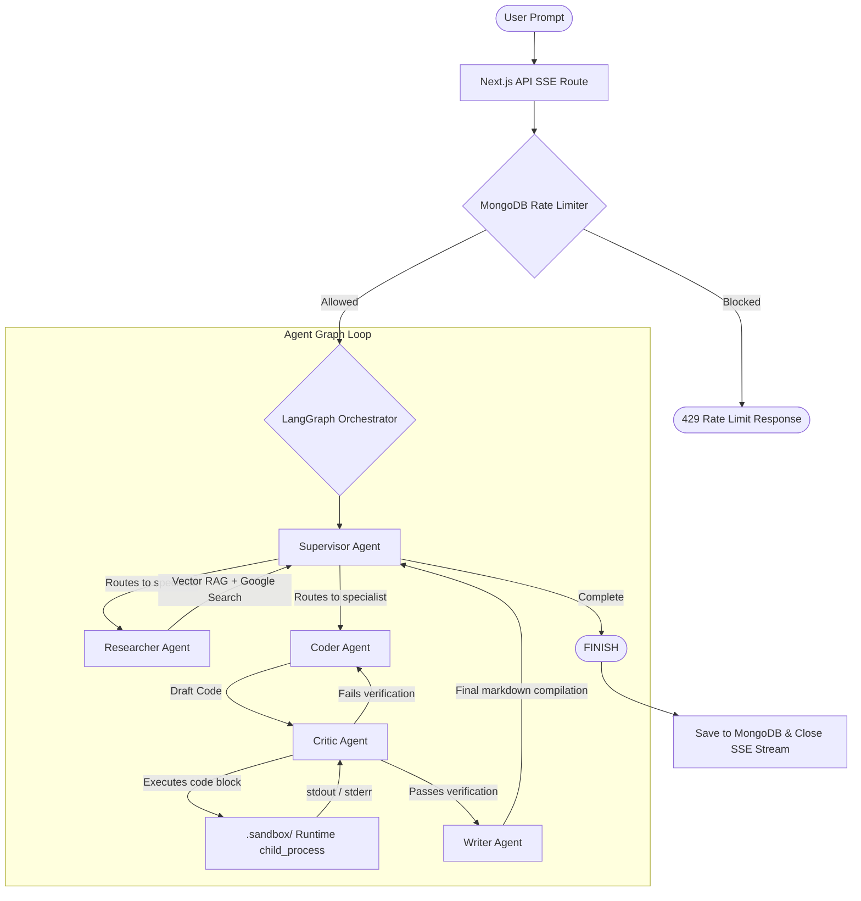

# 🛠️ AgentForge: Technical Interview Preparation Guide

This guide is designed to prepare you for technical interviews where you highlight **AgentForge** on your resume. It details the architecture, design choices, trade-offs, and critical system questions you may be asked.

---

## 🚀 1. The 30-Second Elevator Pitch
When an interviewer asks, *"Tell me about the most interesting project on your resume,"* use this pitch:

> **"I built AgentForge—an advanced multi-agent orchestration platform using Next.js 15 (App Router), LangGraph.js, and MongoDB.** 
>
> **The platform coordinates a collaborative team of specialized AI agents (Supervisor, Researcher, Coder, Critic, and Writer) to solve complex user prompts. It features a secure code execution sandbox that runs generated JS/TS/Python code to verify correctness before outputting responses, a MongoDB-backed sliding-window rate limiter, and a serverless-resilient background AI Cron Engine that automates repository audits (fetching code via shallow cloning, indexing it dynamically into a Vector RAG store, and emailing audit reports via Nodemailer).**
>
> **Through this project, I tackled deep issues like managing stateful agent loops, streaming Server-Sent Events (SSE) over POST requests, handling serverless runtime constraints in Next.js, and implementing fallback vector-to-keyword search pipelines."**

---

## 📐 2. System Architecture & Component Breakdown

### 🧠 A. Multi-Agent Orchestration (LangGraph.js)
* **File Location**: [graph.ts](file:///c:/Users/Sukumar/Desktop/node%20basics/projects/AgentForge/src/lib/agents/graph.ts)
* **How it works**: Uses `@langchain/langgraph` to construct a state graph where each agent is a node, and transition paths are edges. 
* **State Management**: The state schema `AgentState` utilizes a custom **reducer pattern** for messages (`x.concat(y)`), ensuring message history remains append-only.
* **Nodes**:
  1. **Supervisor**: Determines the next step using a classification prompt. If work is incomplete, it routes to `Researcher`, `Coder`, or `Writer`. If completed, it returns `FINISH` to hit the `END` state.
  2. **Researcher**: Generates vector lookup parameters, runs text vector search, and couples it with Google Search Grounding to compile a research summary.
  3. **Coder**: Generates the code structure or technical implementation details.
  4. **Critic**: Runs code blocks in a sandbox. If execution fails (exit code !== 0) or logic is invalid, it starts response with `FAIL` and routes back to `Coder`. Otherwise, returns `PASS` and goes to `Writer`.
  5. **Writer**: Cleans, refines, and formats the output into clean, consumer-ready markdown.

### ⚡ B. Secure Code Sandbox
* **File Location**: [executor.ts](file:///c:/Users/Sukumar/Desktop/node%20basics/projects/AgentForge/src/lib/sandbox/executor.ts)
* **How it works**: 
  - Regex parses the generated markdown to extract code blocks under `javascript`, `js`, `typescript`, `ts`, `python`, and `py`.
  - Writes the raw code block contents to a temporary file inside local `.sandbox/`.
  - Spawns a child process using `child_process.exec` running `node` (JS), `npx --yes tsx` (TS), or `python` (Python).
  - Captures `stdout`, `stderr`, and `exitCode` with a **15-second execution timeout** to prevent infinite loops.
  - Automatically cleans up (deletes) the temp files.

### ⏰ C. Background AI Cron Engine
* **File Location**: [scheduler.ts](file:///c:/Users/Sukumar/Desktop/node%20basics/projects/AgentForge/src/lib/cron/scheduler.ts)
* **How it works**:
  - Leverages a global variable `global.cronSchedulerActive` in the Next.js runtime to ensure hot-reloading doesn't spawn duplicate interval loops.
  - Evaluates active database jobs cached in-memory (refreshed every 15s) against the current clock time.
  - For **GitHub Audits**: Spawns `git clone --depth 1` (shallow clone) to retrieve code quickly. Recursively crawls directory for files `<50KB`. Chunk-ingests files into the MongoDB vector store. Runs the agent graph pipeline asynchronously. Automatically deletes local clones and purges temp vector indices from the database post-execution. Send execution logs and session link via **Nodemailer SMTP**.

### 🔒 D. Sliding-Window Rate Limiter
* **File Location**: [limiter.ts](file:///c:/Users/Sukumar/Desktop/node%20basics/projects/AgentForge/src/lib/ratelimit/limiter.ts)
* **How it works**:
  - Uses Mongoose to query the `RateLimitEvent` collection in parallel (`Promise.all`) inside two sliding time-windows: **1 minute** (RPM check) and **24 hours** (RPD check).
  - If limits are exceeded, it queries the oldest record inside the window to compute exact `retryAfter` seconds for the header response.
  - Uses MongoDB TTL indexes (`expires: 86400`) on the `timestamp` field to automatically prune logs without cron cleanup overhead.

---

## 🧠 3. Deep Architectural Q&A (Be Ready to Answer!)

### Q1: "Why did you use LangGraph instead of simple chain-of-thought prompting?"
> **Answer:** 
> *"Simple chain-of-thought is linear and fragile. If an LLM makes a mistake writing code or retrieval logic early on, the error cascades to the user. LangGraph allowed me to model the system as a stateful graph with feedback loops.*
> 
> *For example, when the Coder outputs bug-ridden code, the Critic runs the code in the sandbox, logs the stderr, and routes the state back to the Coder with execution output. This self-healing loop runs automatically without manual user correction."*

### Q2: "How does the Server-Sent Events (SSE) stream handle POST requests in Next.js?"
> **Answer:** 
> *"Standard HTML5 `EventSource` only supports GET requests, which makes passing complex JSON payloads (like long chat histories or context variables) hard. In `src/app/api/chat/stream/route.ts`, I built a POST endpoint that returns a custom `ReadableStream` with `text/event-stream` headers.*
> 
> *On the client side in `AgentConsole.tsx`, I fetch the POST route, grab `response.body.getReader()`, and process the stream chunk-by-chunk using `TextDecoder`. I split events by `\n\n` and parse the standard SSE `event:` and `data:` markers manually."*

### Q3: "Your rate limiter uses MongoDB to track requests. Why not Redis?"
> **Answer:** 
> *"Using MongoDB is an excellent starting choice to minimize external service dependencies and keep the tech stack unified, especially when utilizing TTL indexes for automatic pruning. However, at scale, MongoDB is a major bottleneck because every incoming API request requires a disk/memory read and write, which introduces database latency.*
> 
> *For a production scale-up, I would migrate this to **Redis**. Using Redis sorted sets (ZSET), we can run sliding-window checks in a single memory operation (`ZREMRANGEBYSCORE`, `ZCARD`, and `ZADD`) within a Redis transaction, reducing latency from ~30ms to under 2ms."*

### Q4: "Next.js routes are serverless-first. How does your background Cron interval run in a serverless environment like Vercel?"
> **Answer:** 
> *"Next.js serverless functions (like Vercel Lambdas) are stateless and short-lived. A standard `setInterval` inside server memory will fail because the container freezes or shuts down as soon as the HTTP request lifecycle completes.*
> 
> *In development or on a VM (like Docker/EC2/Railway), `setInterval` works because of the persistent Node process. For a serverless production deploy, I would disable the in-memory polling loop and trigger the server action endpoint `/api/cron/run` externally using a service like **Vercel Cron Jobs**, **Upstash QStash**, or **AWS EventBridge**."*

### Q5: "How does the system handle concurrent cron executions from multiple scaled server instances?"
> **Answer:** 
> *"In a horizontally scaled environment (multiple server containers running behind a load balancer), each instance would run its own interval check and pull the database, leading to duplicate runs of the same Cron Job.*
> 
> *To solve this, I would implement **distributed locking**. By using a Redis-based lock library (like Redlock) or a MongoDB transaction-backed status update (`findOneAndUpdate` with atomic states like `lastRunStatus: "PENDING" -> "RUNNING"`), we can guarantee only one server claims the execution right for a given timestamp."*

### Q6: "What are the security vulnerabilities of your current Code Sandbox, and how would you secure it?"
> **Answer:** 
> *"My current sandbox uses `child_process.exec` on the local machine. This is a severe security risk in production: malicious code could read `.env` secrets, access local system files, perform network attacks, or cause resource exhaustion (fork bombs/infinite loops).*
> 
> *To productionize this, I would migrate to an isolated container runner. Specifically, I'd send code blocks to a micro-container runtime like **Docker containers** with disabled network interfaces and strict memory limits, or utilize specialized sandbox APIs like **WasmEdge** (WebAssembly) or lightweight firewalled MicroVMs like **AWS Firecracker**."*

### Q7: "What is your RAG vector search strategy, and what is your fallback mechanism?"
> **Answer:** 
> *"I chunked uploaded documents into 1000-character windows with a 200-character overlap to retain context across boundaries. I use Gemini's `gemini-embedding-2` to create 768-dimension vectors and query them using MongoDB's `$vectorSearch` aggregation stage.*
> 
> *Because Atlas Vector Search requires an active search index that might not exist in local development or offline states, I built a smart **Regex Keyword Search fallback**. It strips stop-words, extracts word stems, and runs an index-backed `$regex` match to make local development and offline environments completely seamless."*

---

## 🛠️ 4. Typical Scenario Prompts: "Describe a Time When..."

### Scenario A: Managing API Rate Limits and Quotas
> **The Story:** *"During bulk uploads of repository code files for RAG, I frequently hit Gemini API rate limits (HTTP 429), crashing the ingestion pipeline. I resolved this in `src/lib/rag/embedder.ts` by doing two things: first, I introduced a `1.5-second sleep` between sequential embedding creations; second, I implemented an **exponential backoff retry wrapper** around the Gemini API call that catches 429 exceptions and retries up to 5 times. This stabilized ingestion without hitting API quotas."*

### Scenario B: Debugging Hot-Reload Duplications
> **The Story:** *"In Next.js local development, saving files triggers hot-module-reloads. I noticed that every reload re-ran the scheduler initialization, creating multiple concurrent interval loops that triggered cron tasks multiple times simultaneously.*
> 
> *I fixed this by using the Node **Global Object pattern** in `src/lib/cron/scheduler.ts`. By checking and setting `global.cronSchedulerActive = true`, the scheduler checks if an instance is already active in the global memory space and prevents duplicate loops from starting, keeping logs clean."*

---

## 💡 5. Recommended Architecture Improvements (To Sound like a Senior Dev)
During the interview, point out features you would add next to show foresight:
1. **Queueing Task Architecture**: Replace immediate agent spawning with a background message queue (e.g., **BullMQ** + **Redis**). This prevents heavy AI operations from timing out standard API routes.
2. **Serverless DB Connections**: Explain how you manage Mongoose connections. (Show that you know Next.js serverless functions require reusing DB connection pools rather than spawning new connections on every request, which is handled in [mongodb.ts](file:///c:/Users/Sukumar/Desktop/node%20basics/projects/AgentForge/src/lib/db/mongodb.ts)).
3. **Advanced RAG (Hybrid Search)**: Implement Reciprocal Rank Fusion (RRF) to combine results of Atlas Vector Search and keyword search for maximum retrieval accuracy.
